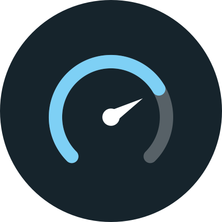

# Crunch-o-meter

Keep an eye on your BOINC machine from your phone.

- **Tasks:** progress on everything running, what's queued, and what finished recently.
- **Gridcoin:** your magnitude, wallet balance and pending research reward.
- **System:** CPU and GPU load with live graphs, temperatures, clocks, power draw, VRAM and fan speed.
- **LACT:** your GPU overclock, power limit and fan settings, view-only.
- **Home screen widget:** the key numbers at a glance, transparent by default.

Free, open source, no ads, no trackers.

## How it works

Crunch-o-meter has two parts:

- a small **server** that runs on the computer doing the crunching, and
- the **Android app**, which talks to that server over [Tailscale](https://tailscale.com).

Your BOINC client, Gridcoin wallet and GPU tools stay off the network. Only the server listens, and only inside your own tailnet, behind a token.

## What you need

- A Linux computer running BOINC (tested on Arch Linux), with Python 3.11 or newer
- Tailscale on that computer and on your phone
- An Android phone running Android 8.0 or newer
- Optional: the Gridcoin wallet for magnitude and balance, an NVIDIA GPU for GPU stats, and LACT for overclock settings

## 1. Install the server

```bash
git clone https://github.com/aahspaghetticode/crunch-o-meter ~/crunch-o-meter
cd ~/crunch-o-meter/server
python -m venv .venv
.venv/bin/pip install .
```

Create your config and a token. The token is the password your phone uses to connect.

```bash
mkdir -p ~/.config/crunch-o-meter
cp config.example.toml ~/.config/crunch-o-meter/config.toml
.venv/bin/crunch-o-meter gen-token
```

Open `~/.config/crunch-o-meter/config.toml` and paste the token between the quotes in `token = "..."`. Keep a copy for your phone.

Check that it can see everything:

```bash
.venv/bin/crunch-o-meter check
```

Each part shows `[ ok ]`, or `[fail]` with a reason. The usual fixes are below.

| If this fails | Do this |
|---|---|
| BOINC | `sudo usermod -aG boinc $USER`, then log out and back in |
| Gridcoin | see [Gridcoin wallet](#gridcoin-wallet) below |
| LACT | make sure your user is in a group listed under `admin_groups` in `/etc/lact/config.yaml` (`wheel` by default) |
| CPU/GPU | GPU stats need the NVIDIA driver; everything else works without it |

Then start it in the background, and keep it running after reboots:

```bash
mkdir -p ~/.config/systemd/user
cp crunch-o-meter.service ~/.config/systemd/user/
systemctl --user daemon-reload
systemctl --user enable --now crunch-o-meter
loginctl enable-linger $USER
```

## 2. Make it reachable from your phone

```bash
sudo tailscale serve --bg 8765
tailscale serve status
```

The second command prints your server's address, something like `https://my-pc.tail1234.ts.net`. This needs HTTPS turned on for your tailnet: in the Tailscale admin console, go to **DNS** and enable **HTTPS Certificates**.

## 3. Install the app

Download the latest APK from the [Releases](https://github.com/aahspaghetticode/crunch-o-meter/releases) page and open it on your phone.

To get updates automatically, install it with [Obtainium](https://github.com/ImranR98/Obtainium) instead: tap **Add App**, paste `https://github.com/aahspaghetticode/crunch-o-meter`, and tap **Add**. Obtainium installs the latest release and lets you know when a new one is out.

In the app, go to **Settings**, enter your server address and token, tap **Test connection**, then **Save**.

### Widget

Long-press your home screen, choose **Widgets**, and add **Crunch-o-meter**. You can choose what it shows, how see-through the background is, and whether the text is light or dark. To change it later, long-press the widget.

The widget updates every 15 minutes (Android doesn't allow more often in the background), and every minute while the app is open. Tap it to open the app.

## Gridcoin wallet

Crunch-o-meter reads your magnitude and balance from the wallet on the same computer. Turn on the wallet's local RPC by adding these lines to `gridcoinresearch.conf` in your wallet's data folder (usually `~/.GridcoinResearch/`):

```
server=1
rpcuser=crunch
rpcpassword=<a long random string>
```

You can make a random string with `openssl rand -hex 32`. Restart the wallet afterwards. Don't add `rpcallowip`, so the RPC stays private to that computer.

If your wallet's data folder is somewhere else, such as an external drive, point Crunch-o-meter at it in `~/.config/crunch-o-meter/config.toml` under `[gridcoin]`:

```toml
conf_file = "/path/to/your/gridcoinresearch.conf"
```

When the wallet isn't running, the app can show an estimate from your BOINC RAC instead. That needs per-project factors in the config; the comments in `config.example.toml` explain how.

## Troubleshooting

| What you see | What it means |
|---|---|
| **HTTP 502** in the app | Tailscale is fine, but the server isn't running. Run `systemctl --user status crunch-o-meter`. |
| **Server rejected the token** | The token in the app doesn't match the one in `config.toml`. |
| **Can't resolve host** or **timed out** | Tailscale isn't connected on your phone or the computer. |
| Service shows `status=203/EXEC` | The service can't find the program. Make sure you installed with the venv steps above, in `~/crunch-o-meter/server`. |
| Service shows `status=2` | Your config has a mistake. Run `crunch-o-meter check` to see which line. |
| Gridcoin shows **source: none** | The wallet isn't running, or the RPC settings above aren't set. |

To see the server's log: `journalctl --user -u crunch-o-meter -n 50`

## Privacy

The app talks only to your own server, over your own tailnet. It has no analytics, ads or third-party services. Your token stays on your phone and is left out of backups.

## Support the app

Crunch-o-meter is free. Every few days the app shows donation addresses, and you can open them any time under **Settings → Support**.

A code hidden in the source turns the reminders off. If you'd rather not dig, donate and email your transaction hash to shutup@clowds.net, and you'll get the code.

## Contributing

[DEVELOPING.md](DEVELOPING.md) covers building from source, running the tests and how the code is laid out.

## License

MIT. See [LICENSE](LICENSE).
